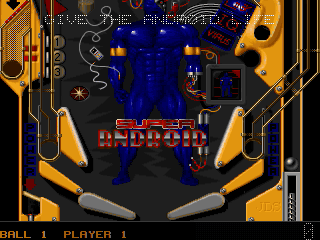
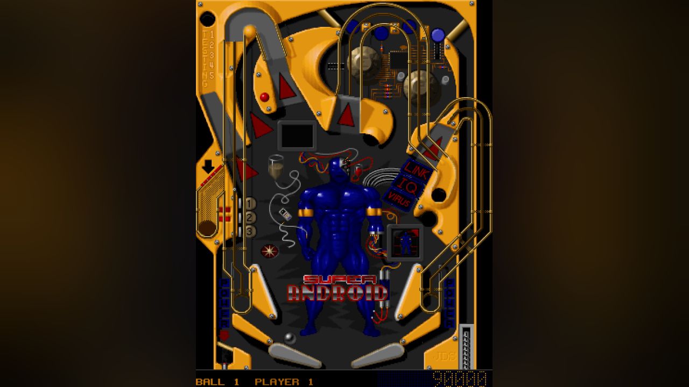
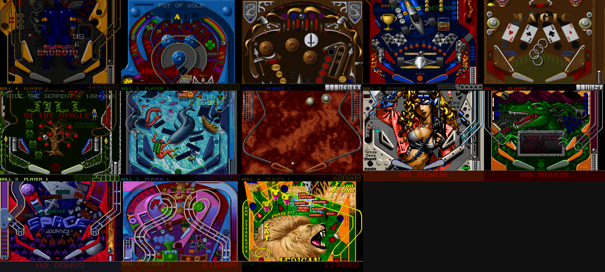
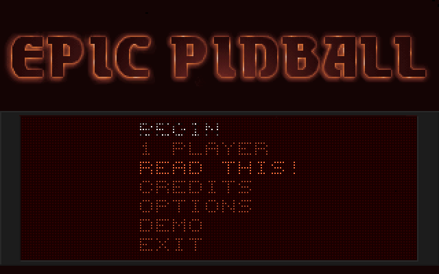
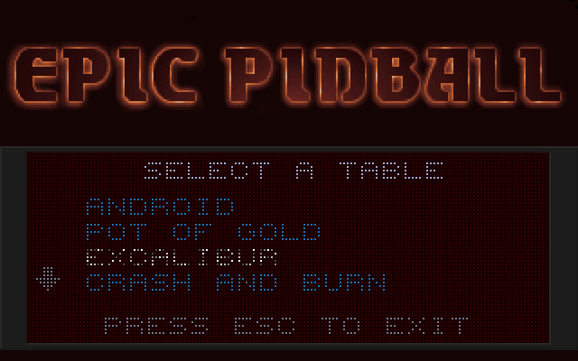
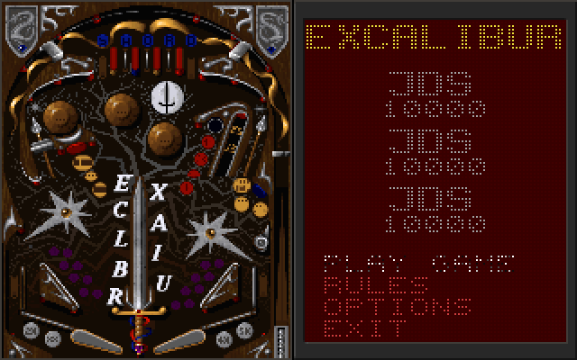

<div align="center">

# Epic Pinball, recompiled

**Epic Pinball** (Epic MegaGames, 1993) — all thirteen tables of the GOG
*Complete Collection*, taken apart from their shipping DOS executables and
rebuilt as one native Windows program. No DOSBox. No emulator.



<sub>*Super Android*, recompiled, mid-game. Recorded headless with the built-in recorder.</sub>

</div>

---

## What it is

A static recompilation of Epic Pinball. `tools/lift.py` lifts the 16-bit x86
of the menu program, every table and the sound drivers to C with the
[pcrecomp](https://github.com/sp00nznet/pcrecomp) toolkit; a small DOS machine
in `src/` answers the DOS, VGA, Sound Blaster, keyboard and timer the game
expects, including running one program from another the way DOS does. You
supply the game; the build produces `epicpinball.exe`.

It is part of the pcrecomp family and follows its house style: the toolkit
ships, the output never does.

## Status

**v0.1.0 — alpha. The menus and all thirteen tables boot and play; the
conformance harness passes 133/133.**

| | |
|---|---|
| Version recompiled | GOG *Epic Pinball: The Complete Collection* 1.01 |
| Programs lifted | `PINBALL.EXE`, `EP1.EXE`–`EP13.EXE`, the MASI mixer and Sound Blaster driver |
| Intro, menus, table select, high scores | ✅ |
| All 13 tables: playfield, scrolling, flippers, plunger, tilt | ✅ |
| Dot-matrix scoreboard (the VGA split screen) | ✅ |
| Music and effects: Sound Blaster 16, 8-bit stereo, 22 kHz | ✅ measured, see below |
| Windowed play at real speed | ✅ (seen on a virtual monitor) |
| Gamepad (XInput, `controller.ini`, GOG's DOSBox mapping by default) | implemented, untested on a real pad |
| `SETUP.EXE` (the sound card menu) | not lifted: its start-up check is answered, and GOG's `SOUNDCRD.INF` (Sound Blaster 16) is used as shipped |
| The `DEMO\` folder's shareware version | not supported |
| A full game, start to final ball, with hands on a keyboard | not yet |
| **Conformance** ([docs](docs/conformance.md)) | **133/133** |

Everything marked ✅ was seen working in scripted headless runs, which the
conformance harness repeats. The sound was checked by measurement — a stereo
stream whose two channels are each smooth signals with a music-shaped
spectrum — not yet by ear. Nobody has played a long session yet: treat this as
an alpha.

## What the remaster adds

The game plays as it shipped; everything here is around it, optional, and
off with `--classic`. Details in [docs/remaster.md](docs/remaster.md).



- **The whole table** (F7): the full playfield on screen at once, no
  scrolling, with the scoreboard under it. Not redrawn — the game keeps the
  entire table in video memory and only ever showed part of it; this shows
  the rest. Made for a tall window or a monitor turned on its side.
- **Its own window**, drawn with Direct3D 11: resizable, borderless
  fullscreen (F11, Alt+Enter), remembered where you left it.
- **Scaling** (F12): sharp-bilinear (default), smooth, CRT, nearest, integer.
  **Vivid** colour (F9). A dark blur of the picture beside it instead of
  black bars.
- **A settings menu** on right-click or F10; choices are kept in
  `saves\epicpinball.ini`.
- **Smooth sound**: the 22 kHz Sound Blaster stream interpolated up to
  44.1 kHz instead of held in steps (Settings → Sound for the original).
- **Xbox controller** mapped by `saves\controller.ini`.

## Screenshots

Every one of these is the recompiled game running.



<sub>All thirteen tables, each mid-game with its scoreboard across the bottom:
Android, Pot of Gold, Excalibur, Crash and Burn, Magic, Jungle Pinball, Deep
Sea, Enigma, Cyborgirl, Pangaea, Space Journey, Toy Factory, African Safari.</sub>

| | | |
|---|---|---|
|  |  |  |
| The main menu | Choosing a table | A table's own screen |

## The game

Epic Pinball came out in 1993 from Epic MegaGames — the company that became
Epic Games. Most tables' own credits say it plainly: *design and graphics by
James Schmalz, music by Robert Allen*. It was shareware: the free table was
*Super Android*, and PINBALL.EXE's closing text still promises that "eleven
more worlds of pinball await". The sound system under it is MASI, Joshua C. Jensen's — its
drivers sign themselves *Licensed to: Epic MegaGames*.
[[Wikipedia]](https://en.wikipedia.org/wiki/Epic_Pinball)

It was written in assembly, and it shows: the tables scroll a 320×240 Mode X
playfield by moving the CRTC start address, put their dot-matrix scoreboard in
the VGA's split screen, lock their timer to the display's vertical retrace, and
run as children of a front end that keeps the music playing under them. The
sound driver's mixer jumps into the middle of unrolled loops. All of that is
lifted as-is; [architecture](docs/architecture.md) and
[lifting](docs/lifting.md) say how.

## Getting Started

You need your own copy of the game. GOG's *Epic Pinball: The Complete
Collection* works, installed or as the offline installer
(`setup_epic_pinball_the_complete_collection_*.exe`). Other versions are untested.

### Quick start

1. Download this repository (Code → Download ZIP) and unzip it anywhere.
2. Double-click **`Setup.cmd`**.

Setup checks for Python 3, CMake, Visual Studio 2022's C++ build tools and Git,
and **asks** before installing any that are missing (it says what, why and how
big). It finds the game (a GOG install, or GOG's installer in your Downloads,
which it unpacks with innoextract without running it — asking first), copies the
game files into `original\`, fetches pcrecomp next to this folder, lifts and
builds, and leaves a shortcut here: **Epic Pinball**. On a fast machine that
takes under two minutes. If anything fails it stops with one sentence on what to
do and writes the details to `setup.log`; running it again carries on from
where it stopped.

### Step by step

Prerequisites: Windows 10/11 x64, Python 3.10+ (`py --version`), CMake 3.20+,
Visual Studio 2022 with the *Desktop development with C++* workload (Build Tools
is enough), Git. ffmpeg is optional (only `--record` needs it).

1. **Get the toolkit**, next to this folder:

   ```powershell
   git clone https://github.com/sp00nznet/pcrecomp ..\pcrecomp
   git -C ..\pcrecomp checkout 1dfdaef
   $env:PCRECOMP_HOME = (Resolve-Path ..\pcrecomp)
   ```

2. **Copy the game in.** Everything in the game's folder that sits next to
   `PINBALL.EXE` goes into `original\` (the `DOSBOX\` folder GOG adds is not
   needed). From GOG's installer instead, unpack it (nothing is run) and copy
   the files from `work\gog`:

   ```powershell
   mkdir work\gog
   innoextract -d work\gog setup_epic_pinball_the_complete_collection_1.01_gog_v2_(86528).exe
   ```

3. **Configure, then lift and build until it settles:**

   ```powershell
   cmake -B build -G "Visual Studio 17 2022" -A x64
   py tools\discover.py
   ```

   Expected output:

   ```
   round 1
     lift
     configure
     build
     play: boot, then each table
   round 2
   ...
   settled after 4 rounds: every address reached is lifted
   ```

   Why rounds: where each table loads, and a few entry points (interrupt
   handlers installed through variables), are learned by running the game. Each
   round plays PINBALL and every table headless for a few seconds and lifts what
   that run recorded ([lifting](docs/lifting.md#5-what-only-running-tells-you)).

4. **Play:** `build\Release\epicpinball.exe`

Usual trip-ups: `python` that opens the Microsoft Store is the App Execution
Alias — use `py`, or turn the alias off in Settings → Apps → Advanced app
settings. A tool installed in this window is not on `PATH` until you open a new
one. `cmake` needs the *Visual Studio* generator line in step 3 on the first run
only.

## Usage

```
epicpinball [options] [-- arguments for PINBALL.EXE]
```

| Keys | |
|---|---|
| Left / right **Shift** | flippers |
| **Space** | start; hold to pull the plunger; nudge |
| **Z** / **/** | nudge left / right |
| **Enter** | show or hide the scoreboard |
| **↑ ↓** | menus; look up and down the table |
| **Esc** | back, quit |
| **F7** | whole table / scrolling view |
| **F9** | colour: natural / vivid |
| **F10**, right-click | settings menu |
| **F11**, **Alt+Enter** | fullscreen |
| **F12** | scaling: sharp → smooth → CRT → nearest → integer |
| **PrtSc** | screenshot to `screenshots\` |

A pad: triggers flip, bumpers nudge, A plunges, d-pad for menus; remap it in
`saves\controller.ini`.

| Option | |
|---|---|
| `--data DIR` | the game's files (default `original`) |
| `--save DIR` | where `CONFIG.PIN` and high scores go (default `saves`); the install is never written to |
| `--window N` | window size, multiples of 320×240 (default 3, or where you left it) |
| `--scale sharp\|smooth\|crt\|nearest\|integer`, `--look natural\|vivid`, `--bars blur\|black`, `--whole-table`, `--fullscreen` | this run's picture; wins over `epicpinball.ini` and is not saved to it |
| `--classic` | the game's own picture: nearest, no extras |
| `--mute` | |
| `--headless` | no window, no audio device, deterministic time — works over RDP |
| `--record out.mp4` | video and audio through ffmpeg (with `--headless`: unattended) |
| `--keys "ms:KEY[+holdms],..."` | scripted input at emulated times, e.g. `"12500:ENTER,14500:ENTER"` |
| `--seconds N`, `--shot-at "ms:file.bmp,..."`, `--wav out.wav`, `--trace` | testing |
| `--present WxH` | `--shot-at` frames through the presenter at that size, headless |

```powershell
# a minute of Super Android, recorded without a window
build\Release\epicpinball.exe --headless --seconds 60 --record android.mp4 `
  --keys "12500:ENTER,13500:ENTER,15500:ENTER,24500:SPACE,26500:SPACE+1500"
```

## Building from source

The [Step by step](#step-by-step) route is the build. What else is here:

| | |
|---|---|
| `tools/lift.py` | one program or driver → C, at the segment it runs at |
| `tools/discover.py` | lift, build, play, repeat |
| `tools/conformance.py` | the scripted checks; `--update` records a new baseline |
| `tests/selftest.c` | the split screen, SB16 stereo and the image registry, with no game data — what CI runs (`cmake --build build --target selftest`) |
| `src/` | the DOS machine: `dos.c` (DOS, BIOS, EXEC), `images.c` (which lifted code is where), `machine.c` (PIC, PIT, keyboard, interrupts), `vga.c`, `audio.c` (SB16, DMA), `host.c` (window, input, recording) |
| `docs/` | [architecture](docs/architecture.md), [lifting](docs/lifting.md), [conformance](docs/conformance.md) |

A trace build (`cmake -B build-dbg -DEPIC_TRACE=ON`, then
`cmake --build build-dbg --config RelWithDebInfo`) keeps a ring of the lifted
functions entered and adds a watchdog that names the generated C line the game
is stuck on; [lifting](docs/lifting.md#debugging-kit) lists the rest.

This needs pcrecomp 1dfdaef or later: 32-bit addressing in the 16-bit decoder
and lifter (pcrecomp#74) and `jmp reg` tables lifted as switches (pcrecomp#75).

**The generated source is not distributed.** Everything lifted from the game —
`work/gen/`, the layout and entry lists — is produced on your machine from your
copy, and `.gitignore` keeps it out of this repository.

## License

MIT for this repository's code ([LICENSE](LICENSE)). Epic Pinball is commercial
software; no part of the game, and nothing generated from it, is in this
repository ([NOTICE](NOTICE)).
