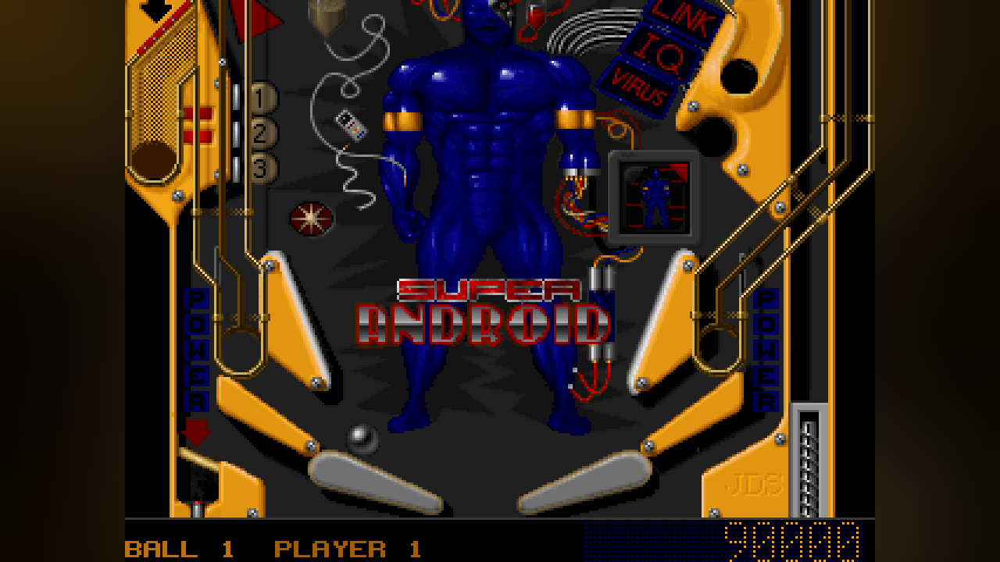
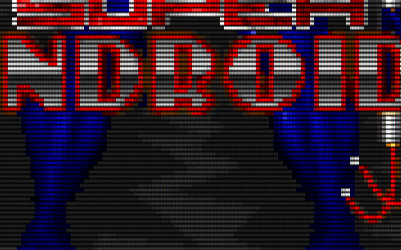

# The remaster

Everything here sits around the game's own code and changes nothing it does:
the tables, their physics and their timing are the recompiled originals. The
pieces follow the other pcrecomp recomps: the presenter is the Gunman
Chronicles recomp's, the blurred bars and the settings menu are Red Alert 2's,
`controller.ini` is Gunman's. `--classic` turns all of it off.

| Key | |
|---|---|
| **F7** | whole table, or the game's scrolling view |
| **F9** | colour: natural, vivid |
| **F10**, right-click | the settings menu |
| **F11**, **Alt+Enter** | fullscreen (borderless, on the window's monitor) |
| **F12** | scaling: sharp → smooth → CRT → nearest → integer |
| **PrtSc** | screenshot of what is on screen, to `screenshots\` |

The game never uses F7–F12 or the mouse, so taking them costs it nothing.

## The whole table


Epic Pinball's tables are taller than the screen. The game draws each one
whole into video memory and scrolls by moving the CRTC's start address, so a
320×240 monitor sees 221 rows (210 on tables 9–13) of a table of nearly 400, with the dot-matrix
scoreboard under them (the line-compare split, see
[architecture](architecture.md)).

Video memory holds the table twice, in two pages 400 rows (32,000 bytes)
apart, for flicker-free page flipping:

| | scoreboard | page 1 | page 2 |
|---|---|---|---|
| tables 1–8 | 19 rows shown, 20 kept | offset 1600 | offset 33600 |
| tables 9–13 | 30 rows shown and kept | offset 2400 | offset 34000 |

The second page runs to the end of the 64 KB plane, which makes a page 399
rows on tables 1–8 and 394 on 9–13. The start address says which page is in
front; `vga_compose_table` (src/vga.c) draws that page from its first row and
the scoreboard under it, 320×418 or 320×424. The ball is in the page wherever
it is on the table, because the game draws it there before it flips. Nothing
is redrawn or guessed: it is the game's own picture, more of it.

The layout comes from the start addresses every table actually writes
(logged over a scripted game on all thirteen) and is derived from the CRTC
registers at run time, so no table has a constant of its own. Menus, the
intro and anything that is not a table in Mode X 240 with a split show as
usual.

## The presenter



`src/present.c` scales the frame on the GPU with Direct3D 11 (WARP when there
is no GPU), into a window of any size:

- **sharp** (the default): sharp-bilinear. Whole pixels stay crisp and only
  their edges blend, so the picture neither blurs nor shimmers at any size.
- **smooth**: bilinear.
- **CRT**: scanlines and an aperture grille, faded in from 1.5× (below that
  they beat against the screen's pixels).
- **nearest**, **integer** (nearest at whole multiples only).
- **Vivid**: a little more saturation and contrast.
- **Beside the picture**: a dark blur of the picture itself, or black.



The 4:3 picture keeps the 4:3 a 1993 monitor gave it; the whole table keeps
square pixels, as Mode X 320×240 has. If Direct3D 11 cannot start, the window
falls back to a GDI stretch (nearest, or halftone for smooth) and says so on
stderr.

No glow. The SimCity 2000 recomp lights up bright, saturated pixels; here the
brightest saturated colour is the yellow plastic, not the lamps, and it
bloomed the whole playfield.

## Sound

The Sound Blaster plays the game's music and effects at 22,050 Hz; the host
plays 44,100. **Smooth** (the default) draws a straight line between the
DSP's samples; **original** holds each one, the steps a real card's output
filter took away. Settings menu → Sound.

## Settings

Changes made in the window are kept in `saves\epicpinball.ini`, with the
window's place:

```ini
[display]
scale=sharp           ; sharp, smooth, crt, nearest, integer
look=natural          ; natural, vivid
bars=blur             ; blur, black
whole_table=0
fullscreen=0
window=130,130,976,759
[sound]
output=smooth         ; smooth, original
```

The command line (`--scale`, `--look`, `--bars`, `--whole-table`,
`--fullscreen`, `--window N`, `--classic`) wins over the file for that run and
is never written to it. Headless runs read only the command line, so a test
never depends on anybody's preferences.

## The controller

An Xbox controller (XInput) presses keys, so it does whatever the key does.
`saves\controller.ini` is written with GOG's mapping the first time:

| | |
|---|---|
| LT / RT | left / right flipper (Shift) |
| LB / RB | nudge left / right (Z, /) |
| A | Space: start, plunger, nudge up |
| X | Enter: the scoreboard |
| Y / B | Y / N |
| Back, Start | Esc |
| d-pad, left stick | arrows |

Each line is `input = KEY` (`none` for nothing); `trigger` and `stick` set how
far they go before they count. Settings menu → *Controller mapping...* opens
the file; it is read again when the window comes back to the front. Not yet
tried on a real pad.

## On Linux

All of the above, with SDL2 doing what Win32 and Direct3D do on Windows
(`./setup.sh`, README):

- The presenter is SDL's renderer, OpenGL when there is a GPU. Sharp is a
  nearest prescale to whole multiples and bilinear the rest of the way, which
  is what the shader computes; CRT is the shader's beam and grille laid over
  it as a multiply (SDL's software renderer cannot brighten with it, so there
  CRT comes out darker); vivid and the blur are the same CPU code.
- The settings menu (right-click, F10) is a dialog: what is set, the keys for
  it, and buttons for the bars, the sound and `controller.ini` (opened with
  `xdg-open`).
- The pad is SDL's GameController, which gives any pad Xbox names, so
  `controller.ini` maps it as it does on Windows.
- The files are the same: `saves/epicpinball.ini`, `saves/controller.ini`,
  `screenshots/`.

## Testing it

`--present WxH` sends every `--shot-at` frame through the presenter,
offscreen, at that size (on Linux with SDL's software renderer), so all of the above runs headless — over RDP and in
CI. The conformance harness ([conformance](conformance.md)) checks, on a table
with each scoreboard height, that the whole table is the very page the game
scrolls over (the playfield the game shows at the same moment is a band of
it),
that the scoreboard is under it, and that the presenter letterboxes it with
the blur beside it. `tests/selftest.c` checks the page arithmetic and the
sound interpolation without any game data.
